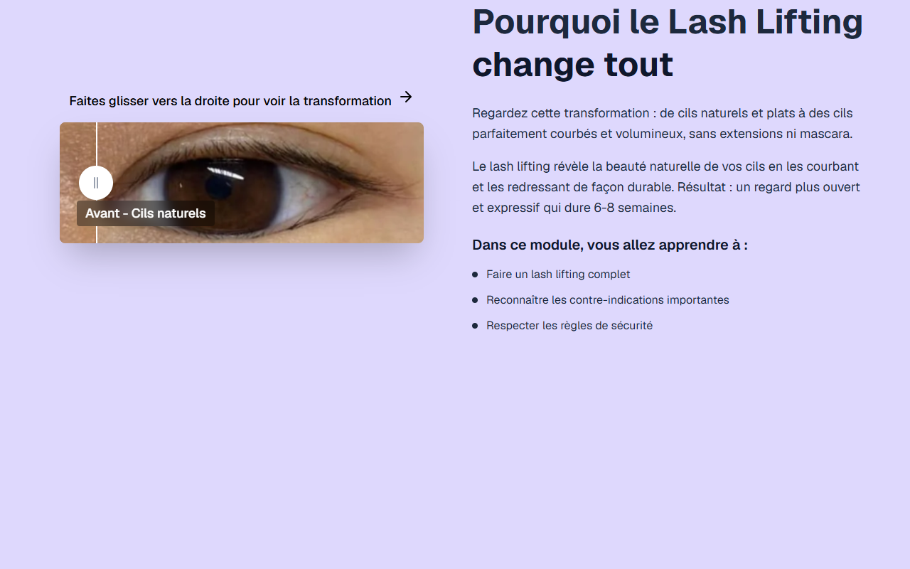

# Intro Slider — LASH LIFTING

**Course:** LASH LIFTING  
**Slide:** 1  
**Live URL:** https://sliderr.edtechiecorp.com  
**Stack:** Next.js · Tailwind CSS · TypeScript · GitHub Pages  

## What this slide does

Opening intro slider for the lash lifting course, introducing the technique, the course structure, and the professional results learners will be able to achieve. Lash lifting is a chemical treatment that curls and lifts natural lashes — this slide explains the concept clearly and visually so learners understand what distinguishes it from lash extensions before entering the course content.

## Screenshot

## Usage

This slide is embedded as an iframe inside Coassemble at the live URL above. DNS is managed via Cloudflare (`edtechiecorp.com`). To update the slide, push to the `main` branch — GitHub Actions will rebuild and redeploy automatically.
